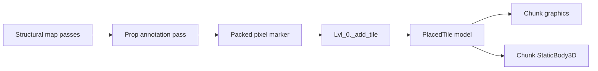

# Requirements

### Goal
Add sparse, deterministic static clutter to Level 0 using the existing procedural tile pipeline.

### Included
- Two initial prop types: **chair** and **trash bin**.
- Prop-specific placement rules generated by `scenes/lvl_0/map_generator.gd` and encoded into reserved bits on each map pixel.
- Static geometry and collision; props are **not pushable** and have no `RigidBody3D` or `PhysicsSounds` behavior.
- Stable placement: regenerating an overlapping world region produces the same prop type at the same coordinate.
- Existing chunk streaming controls prop graphics and collision lifetime.

### Placement Rules
- Only annotate walkable floor tiles after structural generation has finished.
- Chairs favor open floor tiles and use a coordinate-derived cardinal rotation.
- Trash bins require one suitable adjacent wall, orient relative to that wall, and leave the remaining sides open.
- Enforce low density and minimum spacing so clutter remains rare and does not form accidental barriers.
- Exclude the protected spawn area and any tile reserved for a special structure/POI.
- Permit at most one prop marker per tile.

### Out of Scope
- Pushable or persistent object state.
- Additional prop categories beyond chairs and trash bins.
- Gameplay interactions, pickups, destruction, or inventory behavior.
- Lore changes: scattered clutter is already identified as `[interpretation]` in `scenes/lvl_0/docs/NON_CANON.md`.

# Technical Design

### Existing Architecture
- `MapGenerator.Section` stores each generated coordinate as a packed 64-bit `MapGenerator.Pixel` containing biome, tile, and flag fields.
- `MapGenerator.generate_map()` runs the structural map shader over a margin-expanded section before copying its interior, allowing neighborhood checks to remain stable at chunk seams.
- `Lvl_0._add_tile()` in `scenes/lvl_0/lvl_0.gd` translates each pixel into `Model` entries through `_instantiate_model()`.
- `_handle_tile_graphics()` streams duplicated visuals, while `_handle_static_collision_shapes()` copies direct-child collision shapes into the chunk's shared `StaticBody3D`. This is the correct existing path for non-movable props.

### Pixel Contract
Reserve two currently unused high bits without changing `BIOME_MASK`, `WALL_MASK`, or `TILE_MASK`:

```gdscript
const PROP_MASK: int = 0x600000000000

# Within MapGenerator.Pixel

PROP_CHAIR    = 0x200000000000
PROP_TRASH_BIN = 0x400000000000
```

Add typed helpers such as `get_prop(pixel)` and `with_prop(pixel, prop)` so callers do not manipulate these bits ad hoc. Prop bits are annotations layered over an existing walkable tile rather than new tile types, preserving ceiling-light and biome information.

### Generator Changes
Add a dedicated final prop-annotation pass in `map_generator.gd`, invoked after `_run_mapshader()` has settled all walls and arches and before the expanded section is cropped.

- Evaluate chair and bin eligibility from final neighboring pixels.
- Derive chance and priority scores from global coordinates plus a prop-specific hash salt.
- Resolve density/spacing through deterministic local comparison within a radius smaller than the existing generation margin; do not use scan-order-dependent random state.
- OR the selected prop value into the pixel while preserving all existing fields.
- Keep chances, spacing, and spawn exclusion dimensions as named constants for map-preview tuning.

This separate post-pass avoids adding the same prop case to every biome's differently sized pass chain.

### Runtime Changes
- Add project-owned static packed scenes under `scenes/lvl_0/`, for example `part_prop_chair.tscn` and `part_prop_trash_bin.tscn`, each with render geometry and direct-child `CollisionShape3D` nodes compatible with `_load_model()`.
- Load both scenes as `Model` instances near the existing floor/wall model declarations in `lvl_0.gd`.
- Extend `_add_tile()` to inspect `pixel & MapGenerator.PROP_MASK` after base floor/ceiling/wall handling and call `_instantiate_model()` with the selected prop and deterministic angle.
- Infer trash-bin orientation from its adjacent wall; derive chair rotation from its coordinate hash.
- Reuse existing `PlacedTile`, chunk graphics, and shared static-collision handling. Do not introduce another manager or physics lifecycle.

### Data Flow


### Documentation Impact
With explicit permission at implementation time, update:
- `scenes/lvl_0/docs/DESIGN.md` and `SPEC.md` to replace the stale pushable-prop statements with static, map-marked placement.
- `scenes/lvl_0/docs/TECHNICAL.md` with the pixel contract and render path.
- `docs/ai/systems/map_generation.md` with the final annotation pass.
- `docs/ai/STATUS.md` when the feature starts/finishes.

The existing `NON_CANON.md` row remains sufficient; no UI or engine detail should be added there.

# Testing

### Automated Validation
Extend the Level 0 headless map-generation coverage in `scenes/lvl_0/tests/test_map_gen.gd` (or a focused sibling test) to assert:

- Identical world coordinates receive identical markers when generated through overlapping sections.
- Repeated generation of the same section is deterministic.
- Markers occur only on walkable tiles.
- Chair and trash-bin geometry predicates hold.
- No tile contains multiple prop values.
- Minimum spacing and spawn exclusion are respected.
- Both prop types occur in a sufficiently large deterministic sample, without enforcing a brittle exact count.

Update the map preview coloring to make chair and trash-bin markers visually distinct in `result.png`.

### Integration Validation
- Open/run Level 0 and confirm both static scenes render at their marked tiles with correct floor contact and rotations.
- Confirm their collisions block the player without moving.
- Cross chunk boundaries and revisit generated regions to verify positions remain stable and stale nodes/collisions are cleaned up.
- Run `tools/static_check.sh` for the changed GDScript files and the existing `scenes/lvl_0/tests/test_map_gen.sh` harness.

# Delivery Steps

### ✓ Step 1: Encode deterministic prop placement in MapGenerator
Generated Level 0 sections contain stable chair and trash-bin annotations on safe floor tiles.

- Add the reserved prop mask, pixel values, and typed helper functions in `scenes/lvl_0/map_generator.gd`.
- Add a post-generation annotation pass with prop-specific eligibility, coordinate-seeded selection, spawn exclusion, and seam-safe spacing.
- Extend the headless generator checks and preview output to cover determinism, overlap consistency, density, and placement invariants.

### ✓ Step 2: Create static chair and trash-bin scene resources
Level 0 has two reusable static prop scenes compatible with its existing model extraction path.

- Add project-owned chair and trash-bin render resources and Level 0 packed-scene wrappers.
- Provide direct-child `CollisionShape3D` nodes sized to each object for `_load_model()` extraction.
- Verify scene origins, floor contact, scale, and cardinal orientation without adding rigid-body or interaction scripts.

### ✓ Step 3: Integrate clutter with chunk streaming
Level 0 renders and collides with map-marked props through the existing streamed tile lifecycle.

- Load the two prop models in `scenes/lvl_0/lvl_0.gd` and resolve markers in `_add_tile()`.
- Apply deterministic chair rotation and wall-derived bin orientation before `_instantiate_model()`.
- Validate runtime streaming, collision cleanup, and static behavior; run focused map tests and `tools/static_check.sh`.
- After obtaining the required Markdown-edit permission, synchronize `DESIGN.md`, `SPEC.md`, `TECHNICAL.md`, `map_generation.md`, and `STATUS.md` with the implemented behavior.